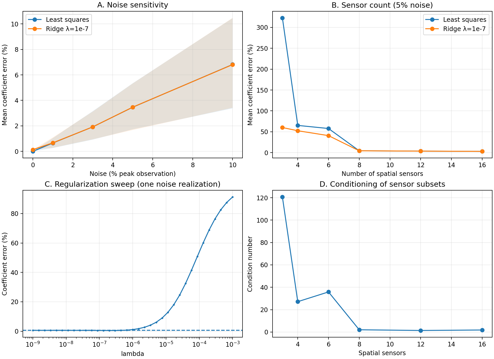
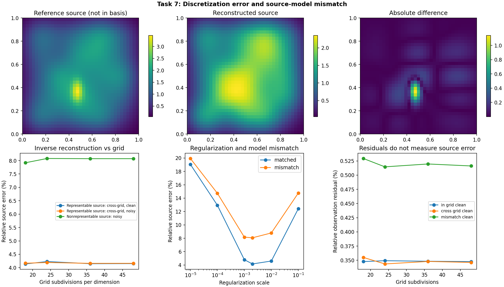
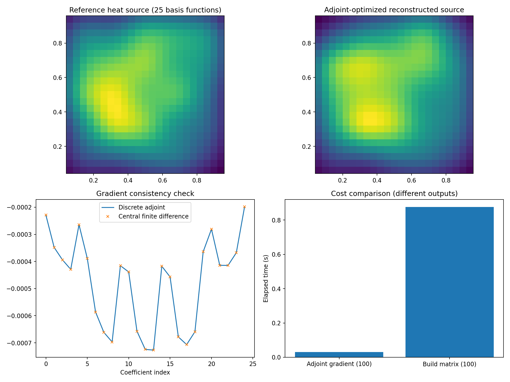
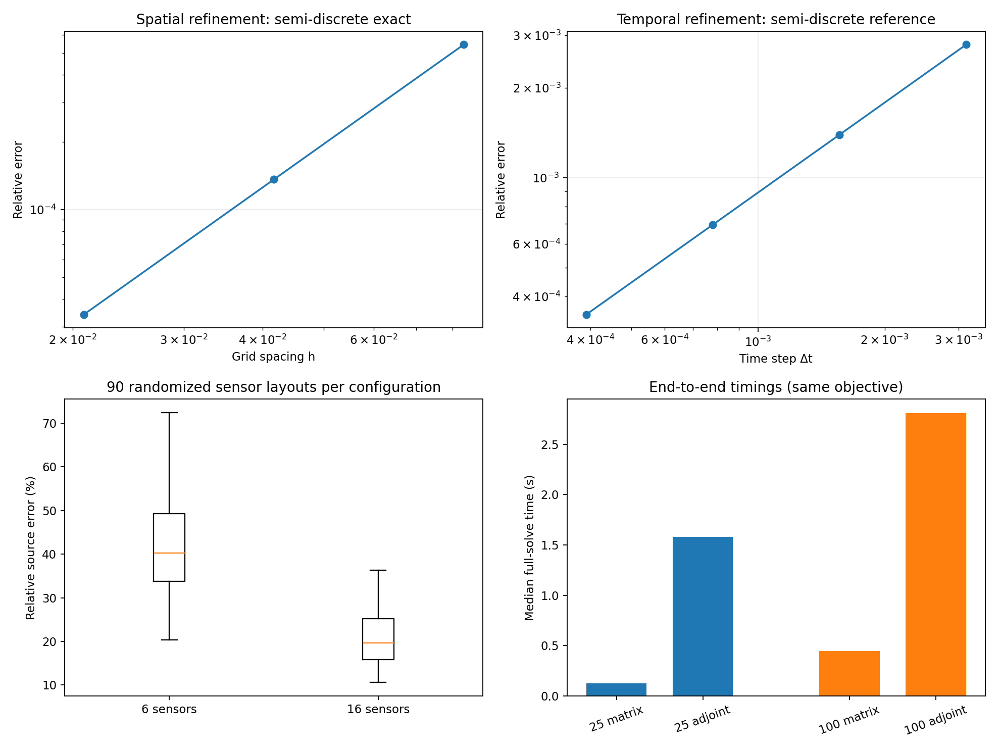

# Inverse Heat-Source Reconstruction

**Numerical analysis and PDE-constrained optimization for a two-dimensional inverse heat-source problem**

An independent computational mathematics project investigating how accurately a spatially distributed heat source can be reconstructed from sparse, noisy temperature observations. The work combines a finite-difference heat-equation solver, Gaussian source parameterization, linear inverse problems, Tikhonov regularization, and discrete-adjoint optimization.

> **Scope:** A reproducible numerical investigation of established methods using *synthetic data*. This repository does not claim a new inverse-problem algorithm, peer-reviewed publication, or experimental validation using physical sensors.

## Research problem

We model heat diffusion on the unit square using the time-dependent PDE

$$
\frac{\partial u}{\partial t}-\alpha\Delta u=f(x,y),\quad (x,y)\in(0,1)^2,\quad 0<t\le T,
$$

with zero initial temperature and homogeneous Dirichlet boundary conditions. The unknown, **time-independent spatial source** is approximated by Gaussian basis functions:

$$
f_{\boldsymbol\theta}(x,y)=\sum_{j=1}^{p}\theta_j\phi_j(x,y).
$$

After numerically solving the heat equation for each basis response and sampling temperature at selected sensors and times, the inverse model becomes

$$
\mathbf d=A\boldsymbol\theta^{\star}+\boldsymbol\varepsilon,
$$

where $A$ is the source-to-observation response matrix, $\mathbf d$ is the observed temperature vector, and $\boldsymbol\varepsilon$ is measurement noise. Predicted observations from an estimated source are $\widehat{\mathbf d}=A\widehat{\boldsymbol\theta}$.

We estimate source coefficients through least squares and zero-order Tikhonov regularization:

$$
\widehat{\boldsymbol\theta}_\lambda=\underset{\boldsymbol\theta}{\mathrm{arg\,min}}\left[\frac{1}{2m}\|A\boldsymbol\theta-\mathbf d\|_2^2+\frac{\lambda}{2}\|\boldsymbol\theta\|_2^2\right].
$$

The project also derives and verifies a **discrete adjoint** of the explicit heat-equation time-stepper to compute gradients without explicitly constructing the response matrix for each optimization evaluation.

## Methods

- **Forward model:** Forward-Time Central-Space (FTCS) finite differences for the 2D heat equation; Taylor-series derivation, stability restriction, and analytical verification.
- **Inverse model:** Gaussian source basis, sensor and observation-time sampling, numerical response matrix, and source-field reconstruction.
- **Stability and uncertainty experiments:** Singular values, numerical rank, observation noise, sensor number and location, and regularization sweeps.
- **Model limitations:** Source-basis mismatch and spatial discretization effects.
- **Optimization:** Direct linear-algebra solutions, quasi-Newton optimization, and verified discrete-adjoint gradients.

## Selected findings

| Experiment | Result and interpretation |
|---|---|
| Independent forward-solver verification | Spatial order approximately **2**, temporal order approximately **1**, for the smooth sinusoidal benchmark and stable steps. |
| Small inverse problem | **0.5684%** relative **source-field** reconstruction error with three Gaussian coefficients in a well-conditioned test case. |
| Matrix conditioning | The 48-by-3 response matrix has condition number approximately **1.806**; the 48-by-25 configuration reaches approximately **1,025**. |
| Sensor placement | Across 90 randomized layouts in each group, mean **source-field** error was **42.15%** with 6 sensors versus **20.96%** with 16 sensors. |
| Source-model mismatch | Reconstruction error was approximately **8%** with an unrepresented narrow source component, versus roughly **4.1–4.2%** for selected representable-source cases. Mesh refinement alone did not eliminate the gap. |
| Discrete adjoint | Relative gradient discrepancy approximately **5.52 × 10⁻¹¹** against central finite differences and **7.98 × 10⁻¹⁶** against the explicit response-matrix gradient. |
| Full-workflow benchmark | Direct matrix solve was faster in these *small linear experiments*: **0.126 s vs 1.582 s** for 25 coefficients; **0.445 s vs 2.810 s** for 100 (matrix vs adjoint, recorded run). |

**Interpretation cautions:** These numbers arise from different experimental configurations; they should not be treated as a controlled comparison of all problem dimensions. Coefficient error, source-field error, and temperature-data residual are distinct metrics. Runtime results depend on the execution environment. An individual adjoint-gradient evaluation is not equivalent to a complete inverse solve.

## Figures

**Noise, sensor count, regularization and conditioning**



**Discretization and source-model mismatch**



**Discrete adjoint verification and reconstruction**



**Independent convergence, randomized sensors, and full-solve benchmarks**



## Repository contents

```text
inverse-heat-source-reconstruction/
├── README.md
├── requirements.txt
├── .gitignore
├── notebooks/
│   ├── 01_forward_heat_equation_colab.ipynb
│   ├── 02_general_spatial_heat_sources_colab.ipynb
│   ├── 03_observation_operator_colab.ipynb
│   ├── 04_inverse_problem_colab.ipynb
│   ├── 05_robustness_executed.ipynb
│   ├── 06_large_inverse_colab.ipynb
│   ├── 07_discretization_model_mismatch_colab.ipynb
│   ├── 08_discrete_adjoint_colab.ipynb
│   └── 09_validation_colab.ipynb
├── data/                       # Saved numerical arrays and JSON metrics
├── figures/                    # Original experimental figures
├── report/
│   ├── technical_report_v0.9.pdf
│   └── technical_report_v0.9.md
└── docs/
    ├── RESULTS_SUMMARY.md
    └── REPRODUCIBILITY.md
```

### Notebook guide

| Notebook | Focus |
|---|---|
| [01 — Forward heat equation](notebooks/01_forward_heat_equation_colab.ipynb) | FTCS solver, analytical solution and initial mesh refinement |
| [02 — Spatial heat sources](notebooks/02_general_spatial_heat_sources_colab.ipynb) | General source shapes and linear superposition |
| [03 — Observation operator](notebooks/03_observation_operator_colab.ipynb) | Sensor observations and response-matrix assembly |
| [04 — Inverse problem](notebooks/04_inverse_problem_colab.ipynb) | Least squares, Tikhonov and source reconstruction |
| [05 — Robustness](notebooks/05_robustness_executed.ipynb) | Noise, sensor counts and regularization sensitivity |
| [06 — Larger inverse](notebooks/06_large_inverse_colab.ipynb) | 25-dimensional inversion and rank/conditioning |
| [07 — Model mismatch](notebooks/07_discretization_model_mismatch_colab.ipynb) | Cross-grid data, discretization and source mismatch |
| [08 — Discrete adjoint](notebooks/08_discrete_adjoint_colab.ipynb) | Adjoint derivation checks and gradient-based optimization |
| [09 — Independent validation](notebooks/09_validation_colab.ipynb) | Separate convergence tests, randomized sensor layouts and benchmarks |

## Getting started

Use **Python 3** in Jupyter Notebook/JupyterLab or Google Colab. To run locally:

```bash
git clone https://github.com/laplacepaul/inverse-heat-source-reconstruction.git
cd inverse-heat-source-reconstruction
python -m venv .venv
source .venv/bin/activate      # Windows PowerShell: .venv\Scripts\Activate.ps1
pip install -r requirements.txt
jupyter lab
```

Open the notebooks from `notebooks/` in numeric order. **Some notebooks expect earlier output files such as `phase3_observation_data.npz` in their current working directory.** Saved results are included under [`data/`](data/). Copy the relevant NPZ file into the active notebook working directory, or adjust that notebook's load path before running. Colab working directories can differ from local Jupyter directories.

For the full explanation and known reproducibility limitations, see **[docs/REPRODUCIBILITY.md](docs/REPRODUCIBILITY.md)**. The notebooks were previously run and results archived, but the complete nine-notebook sequence has **not yet been freshly rerun from a clean environment** using this exact folder layout; environment-specific timing values should not be expected to reproduce exactly.

**Security note:** `phase8_results.npz` contains a legacy object-valued `metrics` member. Use [`data/phase8_metrics.json`](data/phase8_metrics.json) for those metrics, and avoid untrusted pickle-based NPZ loading.

## Technical report

Read the mathematical derivations, literature discussion, experimental designs, results and limitations in the [**Technical Report — review version 0.9 (PDF)**](report/Inverse_Heat_Source_Reconstruction_Technical_Report.pdf.pdf). The [editable Markdown source](report/technical_report.md) is also included.

**Status:** The technical report is a public-review draft, not a peer-reviewed publication or a finalized thesis. Publication-facing typesetting and final editorial verification are still in progress.

## Key references

- R. J. LeVeque, *Finite Difference Methods for Ordinary and Partial Differential Equations*, SIAM (2007). https://doi.org/10.1137/1.9780898717839
- P. C. Hansen, *Discrete Inverse Problems: Insight and Algorithms*, SIAM (2010). https://doi.org/10.1137/1.9780898718836
- C. R. Vogel, *Computational Methods for Inverse Problems*, SIAM (2002). https://doi.org/10.1137/1.9780898717570
- M. Hinze et al., *Optimization with PDE Constraints*, Springer (2009). https://doi.org/10.1007/978-1-4020-8839-1
- M. B. Giles and N. A. Pierce, “An Introduction to the Adjoint Approach to Design,” *Flow, Turbulence and Combustion* (2000). https://doi.org/10.1023/A:1011430410075
- S. S. Adavani and G. Biros, “Multigrid Algorithms for Inverse Problems with Linear Parabolic PDE Constraints,” *SIAM Journal on Scientific Computing* (2008). https://doi.org/10.1137/070687426

## Project status

Independent numerical research/portfolio study. The nine source notebooks and archived outputs are available for inspection. The methods investigated are established techniques, and the reported contributions are reproducible implementation, verification, experiments and critical comparison—not algorithmic novelty.
